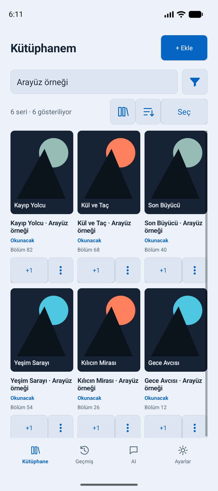
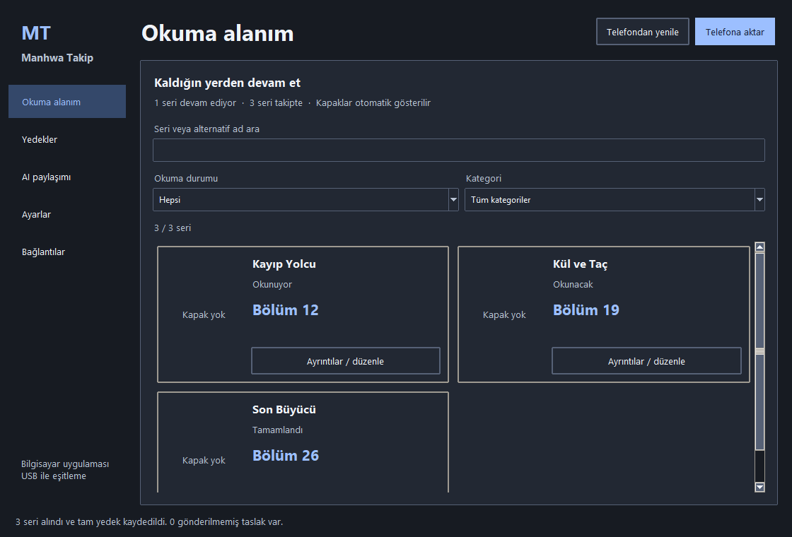

# Manhwa Takip

Manhwa, manga ve benzeri okuma listelerini Android ve Windows üzerinde takip
etmek için geliştirilen açık kaynak uygulama.

## Sürüm ve indirme durumu

Güncel Android sürümü: **0.10.1**; Windows sürümü: **0.10.0**. Paketler
[GitHub Releases](https://github.com/Qylent-Studio/Manhwa-Takip/releases)
sayfasından indirilir:

- `Manhwa-Takip-0.10.1.apk` — Android 8 (API 26) ve üzeri. Release anahtarıyla
  imzalanmıştır; mevcut debug kurulumunun üzerine kurulamayabilir. Ayrıntı:
  [Veri güvenliği ve güncelleme](#veri-güvenliği-ve-güncelleme).
- `Setup.exe` — Windows 11, **0.10.0 (değişmedi)**. Python/Tk ve Pillow çalışma ortamı paket içindedir;
  ayrıca Python kurmayın. Paket imzasızdır; SmartScreen uyarısı görülebilir.
- Her iki dosyanın yanında bir `.sha256` dosyası yayımlanır. Çalıştırmadan veya
  kurmadan önce indirdiğiniz dosyanın SHA-256 değerini bu dosyayla karşılaştırın.

Kaynak kodu da aynı depoda yayımlanır; derleme adımları aşağıda.

## Desteklenen platformlar

- Android 8 ve üzeri.
- Windows 11.
- PC üzerinden telefonla USB işlemleri için USB hata ayıklama ve telefonda
  bilgisayarın RSA anahtarına onay verilmesi gerekir. Bunlar Android uygulamasını
  tek başına kullanmak için gerekli değildir.

## Mevcut özellikler

- Okuma listesi ve eser bilgilerinin yönetimi; okuma durumunun ve bölüm
  ilerlemesinin takibi.
- Kaynak bağlantıları ve kapaklarla çalışma; kaynaklara erişim dış sitelerin
  davranışına ve erişilebilirliğine bağlıdır.
- Yerel veri ve yedekleme akışı.
- Sade Android ayarları: üstte tema, günlük görünüm/kütüphane/yedekleme grupları;
  AI ve bilgisayar bağlantıları açılır **Gelişmiş** bölümündedir.
- GPT'den elle alınan JSON ile eser bilgilerini içe aktarma; uygulama GPT'ye
  otomatik veri yüklemez.
- Windows'ta tema seçenekleri, sistem tepsisi ve isteğe bağlı otomatik başlatma.
  Otomatik başlatma kullanıcı tercihidir.

## İlk kullanım ve kurulum

- Android APK'sını kurup açın: kütüphane çevrimdışı kullanılabilir; PC, AI veya
  eşleştirme temel kullanım için gerekmez.
- Windows Setup, Python/Tk ve Pillow çalışma ortamını içerir; ayrıca Python kurmayın.
  Yeni kurulum telefon bağlı olmadan normal çevrimdışı arayüzü açar.
- Yalnızca PC–telefon bağlantısı için Google'ın resmî
  [SDK Platform-Tools](https://developer.android.com/tools/releases/platform-tools)
  paketindeki ADB'yi kurun ve erişilebilir yapın; USB hata ayıklamayı ve telefonda
  bilgisayarın RSA isteğini onaylayın.
- Windows **Bağlantılar → İlk eşleştirmeyi hazırla** açık onayınızla ilk yerel
  anahtarı oluşturur. Ardından **Tamamen çık** ile kapatıp yeniden açın.
  MCP kurulumu/anahtar gösterimi ayrı işlemlerdir; telefonda eşleştirme ve paylaşım
  onayını ayrıca verin. Normal yeni kullanıcı akışında elle CLI komutu gerekmez.
- Windows paketi imzasızdır; SmartScreen uyarısı görülebilir. Çalıştırmadan önce
  kaynak/yayıncıyı ve dosyanın SHA256 değerini güvenilir sürüm bilgisiyle doğrulayın;
  korumaları körlemesine kapatmayın.

## Ekran görüntüleri

Görseller sentetik örnek veriler içerir; kişisel kütüphane değildir.




## GPT JSON içe aktarma

1. GPT çıktısını kendiniz alın ve JSON içeriğini uygulamaya elle aktarın.
2. Her eser için `title` alanı zorunludur.
3. Yeni eserde durum belirtilmemişse `PLANNED` olur; mevcut eserin belirtilmeyen
   alanları korunur.
4. Önizlemedeki alanları kontrol edin; kayıt ancak sizin onayınızla yapılır.

GPT çıktısı doğruluk garantisi taşımaz. Başlık, bağlantı ve diğer alanları
kaydetmeden önce kontrol edin. Örnek bağlantı: `https://example.invalid/eser`.
AI paylaşımında eser adı (`title`) zorunludur; varsayılan yalnızca addır.
Durum, bölüm, notlar ve diğer isteğe bağlı alanları siz seçersiniz.

## Bilinen kaynak sınırlamaları

- Webtoonhatti ve Manga-TR erişiminde HTTP 403 görülebilir. Uygulama, kaynağın
  erişim kısıtlamasını kaldırmayı garanti etmez.
- Turkmanga'dan gelen kapak bağlantıları geçersiz olabilir.
- PC tarafında WebP kapak işleme Pillow ile yapılır; bozuk veya erişilemeyen
  bir görsel yine de yüklenemeyebilir.

## Veri güvenliği ve güncelleme

Veriler yereldir. Uygulamayı kaldırmadan, cihaz değiştirmeden veya önemli bir
güncelleme yapmadan önce yedek alın ve yedeğin kullanılabilirliğini kontrol edin.
Kaldırma işlemi yerel verilerin kaybına yol açabilir.

Android'de mevcut kurulumun üzerine güncelleme yapılabilmesi için imzalama
kimliğinin devamlılığı önemlidir. Farklı imzalı bir APK kurulumu reddedilebilir;
bu durumda yedek almadan uygulamayı kaldırmayın.
Yeni public release anahtarı, eski debug kurulumunu güncelleyemeyebilir.
Veri koruyan, eski imzayla uyumlu yerel güncelleme ayrı bir pakettir.

Telefon üzerinde MCP ile işlem yapılacaksa önce kullanıcı onayı gerekir.
USB yetkilendirmesi tek başına her telefon işlemi için onay sayılmaz.

## Kaynaktan Android derleme

JDK 17 ve Android SDK 36 gerekir. Windows'ta desteklenen başlatıcı:

```powershell
./build.ps1 testDebugUnitTest lintRelease assembleRelease -PpublicAiConfig=true
```

`testReleaseUnitTest` görevi yoktur. Public derlemede özel HTTP izni içeren,
kaynak paketinden dışlanan `local-ai.properties` bulunmamalıdır; public bayrağını da kullanın.
`assembleRelease` imzasız APK üretir: dağıtım için yerel release anahtarıyla imzalayın.
İmza anahtarını, parolasını veya özel yapılandırmayı asla commit etmeyin.

## Belgeler

- [Gizlilik ve veri kullanımı](docs/privacy.md)
- [Sorun giderme](docs/troubleshooting.md)

## Lisans

[MIT](LICENSE) — Copyright (c) 2026 Qylent-Studio.
Üçüncü taraf içeriklerin ve kaynak sitelerin hakları sahiplerine aittir.
